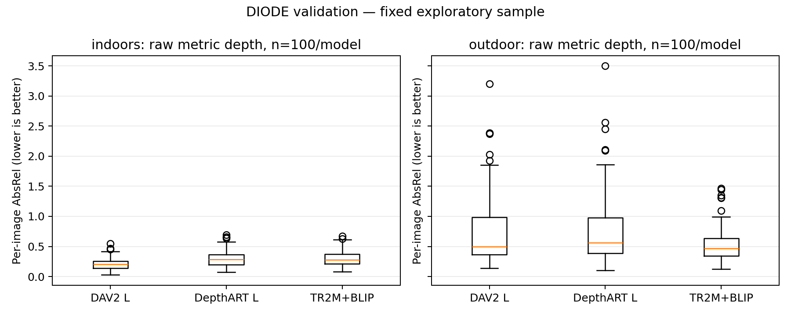
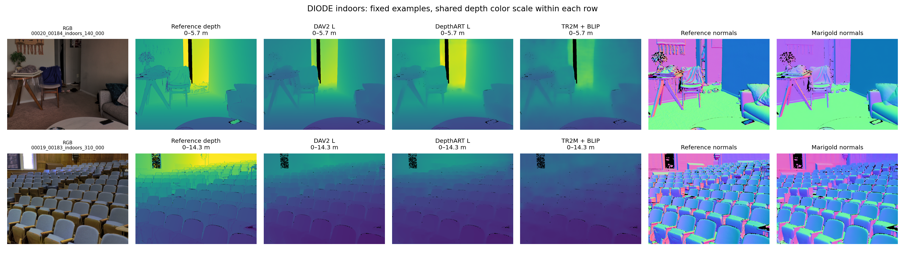
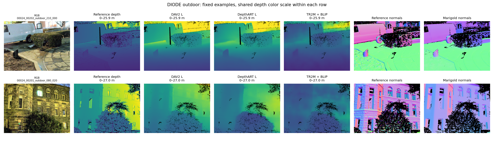

# Stage 1: DIODE estimator validation

Evaluated on **100 indoor + 100 outdoor real DIODE validation images per model**. No training or fine-tuning was performed. Stage 2, GenImage, and optional NYU were not run.

DAV2 is the strongest indoor depth estimator in this run. TR2M with RGB-only BLIP captions has the lowest outdoor AbsRel, while DAV2 retains better outdoor δ1 coverage. Outdoor metric depth remains inaccurate across the tested configurations. These results support treating geometric disagreement as a noisy measurement requiring a real-image baseline, rather than direct evidence of image generation.

## Metric depth

Primary scores use native-resolution sensor-valid references, without prediction clipping or ground-truth alignment. Every image has equal weight within its domain. δ1 is the valid-pixel fraction within a multiplicative factor of 1.25; RMSE is computed per image and then averaged.

| Model | Domain | N | AbsRel ↓ | RMSE (m) ↓ | δ1 ↑ |
| --- | --- | --- | --- | --- | --- |
| DAV2 Metric Large | indoors | 100 | 0.211 | 0.972 | 51.3% |
| DAV2 Metric Large | outdoor | 100 | 0.740 | 7.956 | 31.6% |
| DepthART Metric Large + known K | indoors | 100 | 0.300 | 1.398 | 34.1% |
| DepthART Metric Large + known K | outdoor | 100 | 0.759 | 9.391 | 23.4% |
| TR2M + BLIP captions | indoors | 100 | 0.295 | 1.458 | 31.3% |
| TR2M + BLIP captions | outdoor | 100 | 0.532 | 10.062 | 24.8% |

DepthART uses DIODE's published intrinsics. DAV2 and DepthART use the supplied domain label to select indoor/outdoor checkpoints. TR2M uses its released head with Depth Anything ViT-S, DINOv2 ViT-L, and CLIP ViT-L/14. Its captions are generated by BLIP-base from RGB only and saved for replay. This caption condition differs from the paper's setup.

### Scale versus shape

The following diagnostic multiplies each prediction by `median(GT)/median(prediction)` on its valid mask. It uses ground truth and is **not a deployable accuracy result**.

| Model | Indoor GT-median-aligned AbsRel | Outdoor GT-median-aligned AbsRel |
| --- | --- | --- |
| DAV2 Metric Large | 0.075 | 0.410 |
| DepthART Metric Large + known K | 0.106 | 0.388 |
| TR2M + BLIP captions | 0.114 | 0.462 |

DAV2's indoor error falls from 0.211 to 0.075 under this per-image correction, indicating a substantial scale component. Outdoor aligned errors remain large. Constant global depth scale cancels when converting depth to unit surface normals, so raw metric-depth accuracy alone does not determine consistency quality.

The complete [summary CSV](summary.csv) also reports shared 20 m / 80 m masks and a common 10 m / 80 m mask. Range restrictions do not resolve the main errors: only 0.09% of valid indoor pixels exceed 20 m and 0.36% of outdoor pixels exceed 80 m, on average. The 10 m indoor cutoff excludes 3.18%.

## Surface normals

Marigold Normals v1.1 uses FP16, DDIM, 4 steps, ensemble size 10, processing resolution 768, and a fixed path-derived seed per image. Angles use oriented, unit-normalized vectors; reversals are errors. Scores are averaged per image.

| Domain | N | Mean angular error ↓ | Mean per-image median angle ↓ | Within 11.25° ↑ |
| --- | --- | --- | --- | --- |
| indoors | 100 | 15.4° | 10.5° | 55.3% |
| outdoor | 100 | 19.9° | 12.4° | 45.1% |

All 200 images contain valid normal references. Mean reference coverage is 97.7% indoors and 65.6% outdoors, so these scores describe those supported pixels, not all visible surfaces or sky.

## Depth-derived normal accuracy and consistency

Both depth-derived and predicted normals are expressed in right/up/toward-viewer camera coordinates. The table uses known intrinsics and central-difference radii `r=1` and `r=4` native pixels. Within each radius, every depth model uses the same intersection of reference-normal validity and five-point depth validity. Different radii have different valid support.

| Depth source | Domain | GT normal error, r=1 | Marigold disagreement, r=1 | GT normal error, r=4 | Marigold disagreement, r=4 |
| --- | --- | --- | --- | --- | --- |
| Measured-depth reference | indoors | 16.7° | — | 19.3° | — |
| DAV2 | indoors | 23.0° | 20.1° | 20.2° | 16.7° |
| DepthART | indoors | 32.8° | 30.0° | 32.1° | 29.2° |
| TR2M + BLIP | indoors | 49.8° | 48.4° | 47.9° | 46.4° |
| Measured-depth reference | outdoor | 32.7° | — | 37.8° | — |
| DAV2 | outdoor | 40.3° | 38.6° | 34.3° | 32.0° |
| DepthART | outdoor | 42.6° | 38.6° | 39.6° | 35.5° |
| TR2M + BLIP | outdoor | 55.8° | 54.1° | 54.5° | 52.7° |

The measured-depth row is a check on the derivative operator and reference construction. DIODE normals come from plane fits to measured point clouds; our normals come from derivatives of rectified depth maps. Disagreement between these references includes derivative, boundary, and representation effects and is **not an irreducible sensor-noise bound**. No per-image rotation, normal-sign fitting, or ground-truth correction was applied.

Substantial depth–normal disagreement occurs on these real photographs. TR2M's lower outdoor AbsRel therefore does not establish better local surface geometry. Stage 2 must test whether real/generated distributions separate under a stated masking and aggregation policy; this experiment does not measure detection accuracy. The current consistency masks use ground truth and are not a deployable stage-2 masking policy.

## Camera calibration

GeoCalib pinhole is tested independently against `(fx, fy) = (886.81, 927.06)` in the original 1024×768 images. Focal AbsRel averages the two axis-relative errors per image. No ground-truth focal prior is supplied. The principal point is fixed at the image center by GeoCalib and is not scored as a learned estimate.

| Domain | Successful / attempted | Mean focal AbsRel ↓ | Median focal AbsRel ↓ |
| --- | --- | --- | --- |
| indoors | 100 / 100 | 0.374 | 0.373 |
| outdoor | 100 / 100 | 0.424 | 0.405 |

DepthART and all depth-derived normal computations use known calibration. The effect of GeoCalib estimates on the joint pipeline is not measured here. DIODE's fixed computational intrinsics also limit conclusions about calibration across varied cameras.

## Coverage, validation, and limits

- Fixed SHA-256 selection and RGB checksums: [manifest](../../stage1/manifest.json). Exactly 200 unique matching image records per completed model.
- Three validation scenes per domain, with multiple related crops/scans. Results are descriptive; image count does not imply 200 independent scenes. [Sample statistics](sample_statistics.json).
- Both downloaded DIODE archives matched the authors' MD5 values. Nine Hugging Face checkpoint files matched public LFS SHA-256 values. The TR2M head matched the official Git checkout, and CLIP matched its published URL hash. [Checkpoint verification](checkpoint_verification.json), [runtime and source revisions](runtime_provenance.json).
- Metric tests cover masking, invalid-prediction rejection, oriented normal error, and scale-invariant planar depth normals. Per-image outputs and the full summaries are retained; large prediction arrays, datasets, and weights are excluded from Git.
- **HyDen Metric Point and HyDen Surface Normal were blocked:** both checkpoints require approved authenticated Hugging Face access, unavailable in this environment. No substituted results are reported. [Model status](model_status.json).

## Fixed qualitative examples

The first two manifest entries per domain are displayed; selection does not use model scores. Depth panels share the reference-based display range within each row; values beyond the displayed range saturate. Black pixels indicate unsupported reference measurements. Normal RGB encodes the unit-vector components. These illustrations use reference-valid masks.

## Compute and reproduction

Tested on an RTX 3090 with PyTorch 2.5.1 / CUDA 12.4. DepthART used its official compiled selective-scan extension. Estimated total experiment spend is **$0.53**, within the **$1.50** budget, including the unsuccessful initial V100 setup and transfer charges. Both rented instances have been destroyed. [Cost ledger](costs.json).

See the [protocol and reproduction commands](../../stage1/README.md). Raw [depth summaries](summary.csv), [normal summaries](normal_summary.csv), [geometry summaries](geometry_summary.csv), and [calibration summaries](calibration_summary.csv) are provided alongside per-image JSONL and [saved TR2M captions](tr2m/captions.json).
