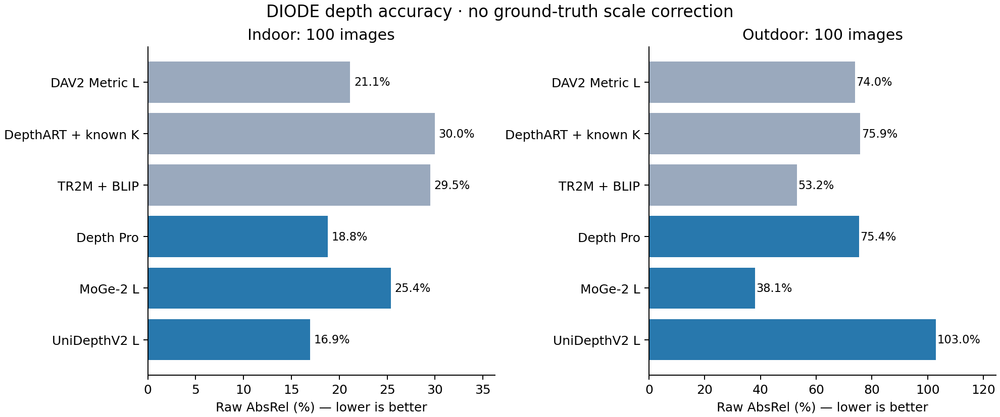
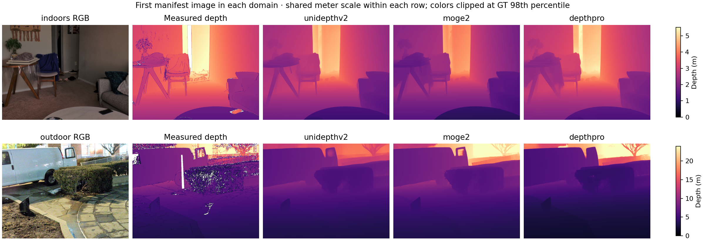

# Stage 1, round 2: three additional metric depth models

Evaluated three additional public models on exactly the original DIODE sample: **100 indoor + 100 outdoor images each, 600 new predictions**. All headline depth errors use the models' original metric outputs, with **no ground-truth scale correction**. Lower AbsRel is better. This is a small stage-1 validation, not an AI-image detection experiment.

## Models selected from official online sources

- **[Depth Pro](https://github.com/apple/ml-depth-pro)** — Apple's 2024 model (ICLR 2025) predicts metric depth and focal length from RGB, with an emphasis on sharp boundaries. Tested the authors' downloadable public `depth_pro.pt`, not a claim to reproduce the paper's exact weights; the authors describe this reference checkpoint as retrained.
- **[UniDepthV2 Large](https://github.com/lpiccinelli-eth/UniDepth)** — 2025 universal metric geometry model that jointly estimates camera and 3D structure. Tested [lpiccinelli/unidepth-v2-vitl14](https://huggingface.co/lpiccinelli/unidepth-v2-vitl14), official `infer`, resolution level 9, no supplied camera. All checkpoint keys loaded strictly.
- **[MoGe-2 Large](https://github.com/microsoft/MoGe)** — 2025 geometry model that predicts a 3D point map, estimates camera geometry, and predicts metric scale. Tested [Ruicheng/moge-2-vitl](https://huggingface.co/Ruicheng/moge-2-vitl), official v2 inference, resolution level 9, no supplied FOV. Its learned scale is an ordinary model output; no reference depth is used to set it.

Exact source commits, model-repository revisions, weight hashes, input integrity checks, and package versions are saved alongside this report. This tests these specific checkpoints/settings, not every variant or every contemporary model.

## Raw distance accuracy

| Model | Indoor AbsRel ↓ | Outdoor AbsRel ↓ |
| --- | ---: | ---: |
| DAV2 Metric Large | 21.14% | 74.00% |
| DepthART Metric Large + known K | 29.97% | 75.86% |
| TR2M + BLIP captions | 29.50% | 53.16% |
| UniDepthV2 Large | 16.94% | 103.00% |
| MoGe-2 Large | 25.39% | 38.13% |
| Depth Pro | 18.79% | 75.43% |

AbsRel is computed at every measured-valid pixel as `abs(predicted_depth - measured_depth) / measured_depth`, averaged within each image, then averaged equally across the 100 images in each domain. For example, predicting 2.4 m for a measured 2 m pixel gives 20% error at that pixel. A score can exceed 100%; large overestimates are unbounded. It does not mean every pixel has that error, nor is `100% - AbsRel` an accuracy percentage.

| Model | Domain | AbsRel ↓ | RMSE (m) ↓ | δ₁ ↑ | Image-median AbsRel | Image P90 AbsRel |
| --- | --- | ---: | ---: | ---: | ---: | ---: |
| UniDepthV2 Large | indoors | 16.94% | 0.738 | 67.4% | 16.96% | 26.50% |
| UniDepthV2 Large | outdoor | 103.00% | 14.836 | 47.6% | 50.05% | 269.30% |
| MoGe-2 Large | indoors | 25.39% | 1.018 | 36.6% | 25.61% | 38.69% |
| MoGe-2 Large | outdoor | 38.13% | 5.840 | 58.2% | 30.53% | 77.31% |
| Depth Pro | indoors | 18.79% | 0.738 | 71.7% | 17.26% | 31.56% |
| Depth Pro | outdoor | 75.43% | 51.525 | 22.4% | 50.34% | 140.22% |

δ₁ is the fraction of reference-valid pixels for which the larger of prediction/reference and reference/prediction is below 1.25, averaged equally across images. It is higher-is-better. RMSE is averaged per image; image-median/P90 describe the distribution of per-image AbsRel scores.

## Surface shape accuracy

For the project, accurate surface shape is also needed. We convert each predicted depth map to normals using known DIODE intrinsics **after inference**, then compare with DIODE's provided reference normals. These intrinsics are not inputs to any of the three new models. This normal evaluation is conditional on known camera calibration; it does not measure an end-to-end pipeline using GeoCalib or the models' own predicted cameras. The table uses central differences with a four-pixel radius, matching the prior round; one-pixel results are also saved.

| Depth source | Indoor normal MAE ↓ | Outdoor normal MAE ↓ |
| --- | ---: | ---: |
| Measured DIODE depth (reference diagnostic) | 19.33° | 37.84° |
| DAV2 Metric Large | 20.25° | 34.30° |
| DepthART + known K | 32.08° | 39.55° |
| TR2M + BLIP | 47.92° | 54.52° |
| UniDepthV2 Large | 17.46° | 23.32° |
| MoGe-2 Large | 16.80° | 22.79° |
| Depth Pro | 18.69° | 27.41° |

The measured-depth row is a reference diagnostic for this differentiation/masking procedure, not an irreducible noise floor. Finite differences, boundaries, depth/normal representation, and reference measurements can all affect it. A smoothed prediction can sometimes score better than differentiating the measured depth. The stencil uses pixels where reference normals and all five reference depth samples are valid. No fitted rotation or sign correction is used.

This is **normal accuracy against ground truth**, not depth–normal disagreement against a separately predicted normal map. We did not rerun Marigold, and did not run stage 2.

## Protocol and interpretation limits

- Same frozen manifest and RGB SHA-256 hashes as round 1. Native 1024×768 output is scored against finite positive depths selected by DIODE's mask; no confidence thresholding, output clipping beyond each official inference routine, or evaluator resizing. Predictions must be finite and positive on every depth evaluation pixel.
- All new models receive RGB only: no reference camera calibration, reference depth, EXIF focal length, or captions. The prior DepthART result uses known calibration and TR2M uses generated captions, so these input differences are labeled.
- MoGe's predicted validity mask is recorded but does not discard difficult reference-valid pixels (`apply_mask=False`). All three models completed the entire sample.
- Primary `full` scores include all reference-valid depths. `capped` (20 m indoor/80 m outdoor) and `common` (10 m indoor/80 m outdoor) scores are in [summary.csv](summary.csv), with identical masks across models. These cutoffs select reference pixels; they do not clamp predictions.
- `median_aligned_abs_rel` and `median_scale` remain in the underlying records for compatibility with the original evaluator. They use reference depth and are **oracle diagnostics, not deployable metric-depth scores**. None of the headline tables or charts use them.
- The sample is small, images can be correlated within scenes, and we have not audited training-set overlap for every model. These are measurements on this particular DIODE sample, not a guarantee on other cameras/domains. Timing fields include inference, tensor transfer and reference depth/mask loading, but exclude metric computation and model loading; they are not a controlled speed benchmark.

## Implications for the project

Distance errors and shape errors need separate model selection. A uniform depth-scale error changes distances but leaves depth-derived normals unchanged when camera intrinsics are fixed. A model can therefore be poor at metric distance while still giving useful surface orientation. Conversely, a low AbsRel does not guarantee detailed surface correctness.

MoGe-2 is a strong next-stage candidate: it improves outdoor distance error and the four-pixel normal score over all three earlier depth models. UniDepthV2 gives the lowest indoor raw distance error in this sample. Use the raw distance and normal tables together to choose the depth estimator for the next experiment. On real images, estimator disagreement already has a nonzero baseline; a large disagreement on one image is not proof of generation. Stage 2 must test held-out real/generated images and measure detection performance, with thresholds chosen without test-set labels. The present run cannot establish that the detector works.

## Fixed examples

The first manifest image in each domain was selected without looking at scores. Colors share a meter scale within each row and saturate at the reference 98th percentile for display only; metrics use all unmodified values. Blank reference pixels lack valid measurements.

## Reproduction and budget

[Runner and commands](../../stage1/README.md#additional-rgb-only-depth-models-round-2) · [per-image/aggregate depth metrics](summary.json) · [normal metrics](geometry_summary.json) · [source revisions](source_revisions.json) · [checkpoint integrity](checkpoint_integrity.json) · [runtime packages](runtime_provenance.json) · [new-run costs](costs.json).

This new run cost approximately **$0.0889** against the **$1.00** budget (observed net account debit $0.0867; billing may lag). The RTX 3090 instance was **destroyed and confirmed absent from the instance list**. This ledger is separate from the previous $1.50 experiment.
