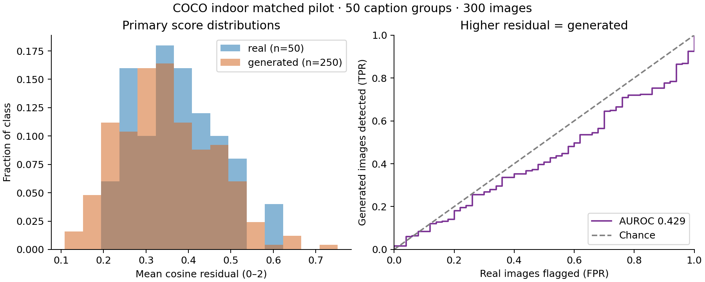
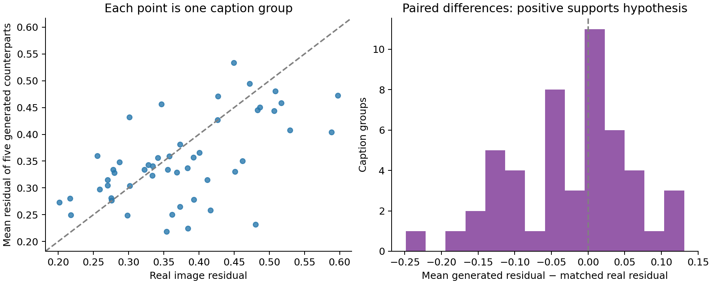
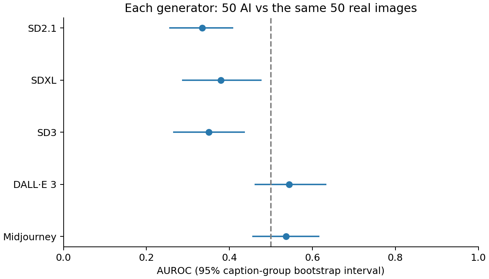

# COCO indoor: caption-matched 300-image pilot

**Primary pooled AUROC: 0.429** (95% **caption-group bootstrap** interval **0.366–0.495**). Higher cosine residual is fixed as indicating generated. AUROC 0.5 is chance and 1.0 is perfect ranking; it is not classification accuracy.

The user approved a pilot of **50 complete caption groups: 50 real photographs + 250 generated images**, with 50 generated images from each of five archive tags. This is **300 of the archive's 16452 images**, not a full-archive inference run.

The primary score runs opposite to the hypothesis on this pilot: higher residual tends to occur on real images. This does not support using higher disagreement as a generated-image indicator. We did not flip the score direction.

## Primary results

| Class | Images | Mean residual (0–2) | Median image residual | Mean valid stencil coverage |
| --- | ---: | ---: | ---: | ---: |
| Real photographs | 50 | 0.3741 | 0.3652 | 100.00% |
| Generated, pooled | 250 | 0.3493 | 0.3407 | 100.00% |

The point AUROC compares all 50 real scores with all 250 generated scores. It measures how often a generated image ranks above a real image, counting ties as half. Unequal class counts do not change chance AUROC from 0.5. The histogram below normalizes each class separately so the fivefold difference in sample count does not exaggerate the generated distribution.

## Caption-matched contrast

For each group, subtract the real image's residual from the average residual of its five generated counterparts, then average across the 50 groups:

`paired difference = mean_over_groups(mean_of_five_AI_scores - real_score)`

Result: **-0.0248 residual units**, 95% caption-group bootstrap interval **[-0.0471, -0.0021]**.

Generated counterparts have a lower mean residual than their matched real reference on this sample; the paired-difference interval is below zero, opposite to the hypothesis.

This contrast controls for the shared caption. It does not imply identical scenes/viewpoints, and it is not a new deployable detector score that assumes a known real counterpart is available.

## Results by generator

Each row compares 50 images with the **same 50 real references**. Tags are copied from the archive; exact generator checkpoint/version provenance is not independently verified here.

| Archive generator tag | AI images | Mean residual | AUROC [95% group-bootstrap interval] | Mean AI − matched real | AI above matched real |
| --- | ---: | ---: | ---: | ---: | ---: |
| sd21 | 50 | 0.3153 | 0.334 [0.255, 0.409] | -0.0588 | 32.0% |
| sdxl | 50 | 0.3295 | 0.380 [0.286, 0.478] | -0.0446 | 40.0% |
| sd3 | 50 | 0.3206 | 0.350 [0.264, 0.437] | -0.0535 | 30.0% |
| dalle3 | 50 | 0.3932 | 0.544 [0.460, 0.634] | +0.0191 | 56.0% |
| midjourney | 50 | 0.3877 | 0.536 [0.455, 0.616] | +0.0136 | 60.0% |

Because each generator contributes 50 images, the mean of the five generator AUROCs equals the pooled AUROC; this identity was checked. Confidence intervals preserve the shared caption/real-image structure. Generator intervals are descriptive and unadjusted for multiple comparisons; this pilot does not establish firm generator rankings. “AI above matched real” is a within-caption score comparison, not classification accuracy or pooled AUROC.

## Same inference method as the supplied cosine experiment

The inference runner and geometry helper match the previous Frontier cosine run **byte-for-byte**. No model or scoring rule was changed for this dataset.

1. **Depth Anything V2 Metric Outdoor Large** predicts axial Z depth; Indoor Large is a separate sensitivity check on every image. No per-image checkpoint routing.
2. **GeoCalib pinhole** estimates camera intrinsics K without priors. It estimates focal calibration and assumes a centered principal point; it does not independently learn all four fx,fy,cx,cy parameters.
3. Back-project `P(u,v)=Z(u,v) K^-1 [u,v,1]^T`; form exactly `P(u+1,v)-P(u,v)` and `P(u,v+1)-P(u,v)`. Normalize their cross product, orient toward the camera, and apply the fixed OpenCV-to-Marigold right/up/toward-viewer coordinate conversion.
4. **Marigold Normals v1.1** independently predicts normals: fp16, 4 DDIM steps, ensemble 10, resolution 768, matching canvas resolution and deterministic image-ID seeds.
5. The image score is the arithmetic mean of **`E=1-clip(dot(unit ND,unit NP),-1,1)`** over valid forward-difference stencils. E ranges from 0 (agreement), through 1 (orthogonal), to 2 (opposite). Exclude only the final row/column and invalid/degenerate predictions. No smoothing, learned-confidence/sky/object-edge filter, absolute dot product, fitted rotation, or ground-truth scale correction.

All models start with identical RGB canvas pixels. DAV2 uses official fp32 `infer_image(input_size=518)`; GeoCalib's wrapper undoes its internal scaling/cropping when returning K. All named GeoCalib parameters matched checkpoint tensors after loading, and both DAV2 checkpoints loaded strictly. Input and processed-pixel hashes agree across phases for all 300 images. There were **no failed or omitted images**.

## Secondary diagnostics

These do not replace the primary result:

| Depth checkpoint | Mean-residual AUROC | Mean-angular-score AUROC | Paired mean residual difference |
| --- | ---: | ---: | ---: |
| Outdoor Large (primary) | 0.429 | 0.413 | -0.0248 |
| Indoor Large (secondary) | 0.477 | 0.464 | -0.0072 |

The angular columns use the same normal fields/masks as the residual columns. Pixelwise `E=1-cos(theta)`, but averaging that residual is not equivalent to transforming the mean angle. Neither a better secondary score nor a reversed score was selected as the headline.

## Archive audit and sampling

Source: user-provided `coco_indoor_all.zip`, **422257484 bytes**, SHA-256 **`c847a0655de51d16724852da1dbe155b0998b8941f80c8a47b2577b8dc71a089`**. Input images/captions are not redistributed in Git.

- The complete archive was downloaded and ZIP-CRC checked; all 16452 JPEGs decoded successfully. It has 2742 images each tagged real, sd21, sdxl, sd3, dalle3 and midjourney, and 2742 complete six-way caption/instance groups.
- Archive-provided split counts are 7074 train, 1578 validation and 7800 test images. The archive contains 10 extra byte-/decoded-pixel-identical copies and 14 caption IDs spanning splits, with no cross-real/AI exact-image duplicate conflicts. These findings informed score-independent sampling.
- We selected 50 test-only groups by deterministic SHA-256 order, one instance per caption ID, excluding caption IDs and decoded-image hashes appearing in train/validation and any repeated selected decoded image. There were 1242 eligible six-way test groups before the one-caption/uniqueness selection. All300 selected images and all 50 selected caption texts are unique; no model scores or visual quality judgments were used.
- The frozen manifest reproduces byte-for-byte from the archive using the committed inventory/sampling scripts. Captions are kept local; the public manifest records IDs, group membership, tags, paths and hashes.

[Full inventory counts](archive_inventory.json) · [Input geometry/JPEG audit](input_geometry_audit.json) · [Frozen manifest](../../stage2/coco_matched_manifest.json).

## Input-resolution and camera caveats

Every stored image is **256×256**, and all 300 selected JPEGs share quantization tables and 4:2:0 chroma subsampling. We kept the previous proportional LANCZOS 1024-long-edge canvas, so this run upsamples every image fourfold along each axis. Upsampling does not restore original geometric detail; both models' internal preprocessors still follow their official APIs.

Original-dimension metadata is nonsquare for **49 of 50 selected real images**, but square for all 250 generated images. The archive does not document whether that conversion involved cropping, stretching or another transform. Such differences may affect apparent camera geometry and surface-normal estimates. A shared stored resolution/JPEG header does not remove original processing or content differences.

## Uncertainty and interpretation limits

The bootstrap draws **50 complete caption groups with replacement**, preserving each real image and all five generated counterparts (2000 replicates, seed180). The same draws are used for subgroup intervals. Treating all 300 images as independent would ignore shared prompts and repeated real references. Different caption groups can still share scene/source similarities; this bootstrap does not resolve every correlation.

This is **agreement between two estimated normal fields**, not geometric error against measured depth/normals. A generated image can yield two mutually consistent but wrong reconstructions, while real images can produce residuals from camera error, texture, sky, boundaries or estimator noise. Caption matching controls prompt content, not exact camera, viewpoint, scene composition or complexity. Labels/generator tags are supplied by the archive; estimator training-set overlap and near-duplicate content have not been exhaustively audited.

No classifier/threshold was trained on Frontier or this pilot, and no score direction was flipped. Fifty real images give 2% empirical false-positive-rate steps, so 1% FPR performance cannot be established. The result applies to this archive/sample and five tags, not all 16452 archive images or unseen generator families. Compare cautiously with the Frontier pilots: data sources, generation systems, image preparation and matching differ.

## Reproduction, validation and budget

[Commands and sampling](../../stage2/README_COCO_MATCHED.md) · [Protocol fixed before inference](../../stage2/PROTOCOL_COCO_MATCHED.md) · [Scores](scores.csv) · [Group scores](group_scores.csv) · [Full records](per_image.jsonl) · [Summary](summary.json) · [Validation](verification.json) · [Input checks](input_verification.json) · [Code checks](code_verification.json) · [Checkpoint checks](checkpoint_verification.json) · [Sources](source_revisions.json) · [Runtime](runtime_provenance.json) · [Packages](runtime_packages.json) · [Costs](costs.json) · [Raw-map hashes](prediction_map_hashes.json).

All **900 raw prediction arrays** (two depths and one independent normal map per image) were retained locally with transfer SHA-256 verification; arrays and original images/captions are excluded from Git. HF weights matched published LFS hashes. GeoCalib's release has no published hash in this workflow; its size/PyTorch ZIP CRC were checked, its actual SHA-256 matched the prior run, and loaded named parameters were verified.

Estimated new-run cost: **$0.1778**, below the approved **$1.00** ceiling. Observed net account debit: $0.1745; billing/counters can lag. The RTX 3090 instance was **destroyed and confirmed absent from the instance list**. This ledger is separate from earlier runs.
