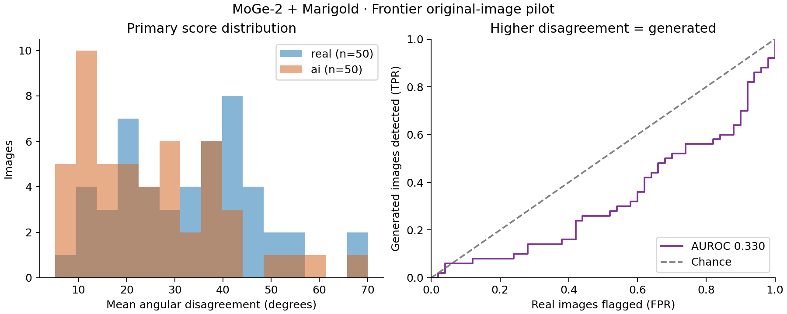
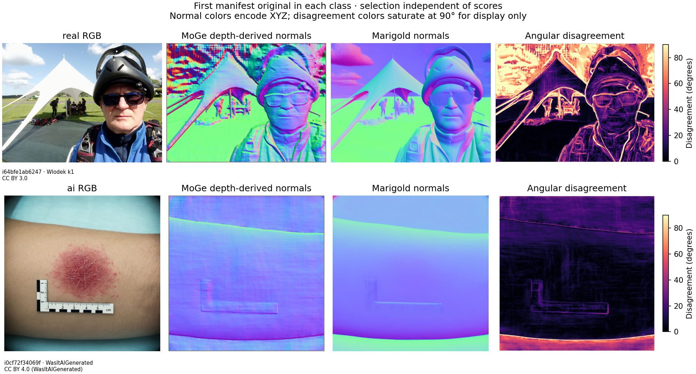

# Stage 2 pilot: 50 real + 50 generated Frontier images

**Primary AUROC: 0.330** (95% stratified image-bootstrap interval **0.227–0.441**). **1.0 is perfect ranking; 0.5 is chance.** Score direction was fixed before inference: higher angular disagreement means more likely generated.

The predeclared signal runs in the wrong direction on this sample: higher disagreement tends to occur on real images. This does not support using high disagreement as a generated-image detector. We did not flip the score to present a better result.

## What was tested

MoGe-2 Large predicts metric depth and camera intrinsics from RGB. We turn its depth into surface normals using its predicted camera, then compare these with independently predicted Marigold Normals v1.1. The image score is the mean angle between the two normal maps, using a four-pixel central-difference radius. No ground-truth depth, normals, intrinsics, fitted scale or rotation is used.

This is **agreement between two estimators**, not their accuracy against measured surface normals. Unlike DIODE, these images have no geometric ground truth. Two estimators can agree on the same incorrect reconstruction.

## Primary results

| Class | Images | Mean disagreement | Median image disagreement | Mean valid interior coverage |
| --- | ---: | ---: | ---: | ---: |
| Real photographs | 50 | 33.26° | 35.34° | 100.00% |
| AI-generated | 50 | 25.19° | 22.39° | 100.00% |

An AUROC of 0.330 means the generated image receives the higher disagreement score in about 33.0% of randomly chosen real/generated pairs, counting ties as half. This is a ranking statistic, not classification accuracy. No test-set optimized decision threshold was selected.

All **100 images completed successfully**, with 100 unique IDs and original byte hashes. The same processed RGB hash was verified for both models for every image. Invalid prediction coverage is recorded; no image was excluded because its score looked difficult. MoGe's predicted validity mask was not used to remove pixels from the primary score.

## Dataset and frozen protocol

Source: [WasItAIGenerated Frontier Image & Video Benchmark (2026–10)](https://huggingface.co/datasets/wasitaigeneratedcom/frontier-image-video-bench-2026-10), public release revision `e6a8b83d15fab1da958848368fcd07e943afafd0`.

- 50 real photos selected by deterministic SHA-256 ordering; 50 generated images selected in deterministic round-robin order across all 19 generators, 2–3 per generator. This balances generator representation rather than following the benchmark's natural generator frequencies.
- Original images only. No video frames, WhatsApp/Instagram/re-shared copies, private split, or benchmark detector scores. IDs and original byte hashes are unique; near-duplicate content has not been exhaustively audited.
- All originals matched public LFS SHA-256 values. Every label, license, author, source URL, original dimension and hash is retained in the [frozen manifest](../../stage2/frontier_manifest.json).
- Both models receive the same RGB image, resized without cropping to an aspect-preserving 1024-pixel longest edge using LANCZOS. MoGe uses resolution level 9 and official fp16 inference. Marigold uses 4 DDIM steps, ensemble 10, processing resolution 768 and a deterministic image-ID seed.
- Primary normals use MoGe's predicted camera calibration, oriented into Marigold's right/up/toward-viewer convention. No ground-truth camera or sign/rotation fitting. This differs from the stage-1 normal-accuracy table, which used known DIODE calibration for evaluation.
- The [protocol](../../stage2/PROTOCOL.md) was fixed and hashed before inference. Primary direction, stencil, aggregation and preprocessing were unchanged. All MoGe checkpoint keys loaded strictly, and all selected model files were hash-verified.

## Secondary diagnostics

These were fixed in the protocol and are reported separately; none replaces the primary result.

| Secondary score (same higher = AI direction) | AUROC |
| --- | ---: |
| radius1_mean_angle_deg | 0.329 |
| radius4_median_angle_deg | 0.360 |
| radius4_mean_abs_facing_component_difference | 0.317 |

## Fixed visual examples

The first manifest image in each class was chosen independently of scores. Normal RGB encodes XYZ direction. Heatmap colors saturate at 90° for display only; numerical scores use the full oriented angle. Sky regions, object boundaries and fine textures can produce disagreement on real photos, while a generated scene can yield two mutually consistent reconstructions.

Image credits (inputs resized; normal maps and heatmaps are derived visualizations):

- `i64bfe1ab6247`: Wlodek k1, CC BY 3.0, [original source](https://commons.wikimedia.org/wiki/File:Parachuting_at_the_Opole-Polska_Nowa_Wie%C5%9B_airfield,_2022.05.29_03.jpg).
- `i0cf72f34069f`: WasItAIGenerated, CC BY 4.0 (WasItAIGenerated), from the linked benchmark.

The assembled example figure is shared under CC BY 4.0 with the above original credits retained. Other sample files retain their per-file licenses and are not redistributed in Git.

## What this means for the project

The predeclared signal runs in the wrong direction on this sample: higher disagreement tends to occur on real images. This does not support using high disagreement as a generated-image detector. We did not flip the score to present a better result.

The stage-1 results showed that these estimators can recover useful geometry on real DIODE images. That does not imply their mutual disagreement is a reliable generation detector. Here the score includes camera-estimation error, unconstrained regions such as sky, boundaries and texture sensitivity, in addition to any actual geometric inconsistency.

A next experiment should use a separate held-out set and control scene content and image processing. If testing a surface/sky mask, boundary exclusion, or a different disagreement rule, fix it on development data and evaluate it on new images; do not select the best change on these same 100 images and call that a new test. Keep this frozen pilot as the baseline.

## Limits

This is a small exploratory public-split pilot, not the publisher's private leaderboard evaluation. Source/domain, scene complexity, aspect ratio and compression can differ by class. Uniform resizing reduces one resolution difference but does not remove these confounders. We have not audited all estimator training overlap. The bootstrap resamples 50 images per class independently (2000 replicates, seed 180); correlations within source/generator/content can make that interval optimistic. With 50 real images, empirical false-positive rates move in 2% increments, so this pilot cannot establish detection at 1% FPR. Per-generator counts are too small for firm model rankings. We did not train a classifier, run additional generators, or optimize a threshold.

## Generator coverage

| Generator | Images |
| --- | ---: |
| alibaba/qwen-image-3 | 3 |
| blackforestlabs/flux-3 | 2 |
| bytedance/seedream/v5/pro | 2 |
| flux-2 | 2 |
| flux-2-pro | 3 |
| google/nano-banana-2.1 | 2 |
| hidream-o1-image | 3 |
| ideogram/v4.5 | 3 |
| kling-image/v3 | 3 |
| krea-2/turbo | 3 |
| luma/agent/uni-1/v1 | 3 |
| meta/muse-image | 2 |
| microsoft/mai-image-2.5 | 3 |
| nano-banana-pro | 3 |
| openai/gpt-image-2 | 2 |
| qwen-image-2512 | 3 |
| recraft/v4.1 | 3 |
| xai/grok-imagine-image/v2.0 | 3 |
| z-image/turbo | 2 |

## Reproduction, verification and cost

[Code and commands](../../stage2/README.md) · [per-image scores](scores.csv) · [full records](per_image.jsonl) · [aggregate metrics](summary.json) · [validation](verification.json) · [checkpoint verification](checkpoint_verification.json) · [source commits](source_revisions.json) · [runtime](runtime_provenance.json) · [package versions](runtime_packages.json) · [cost ledger](costs.json).

The new run cost approximately **$0.0638**, below the **$1.00** ceiling. Observed net account debit was $0.0611; billing/counters may lag. The RTX 3090 instance was **destroyed and confirmed absent from the instance list**. This cost is separate from both stage-1 runs.
