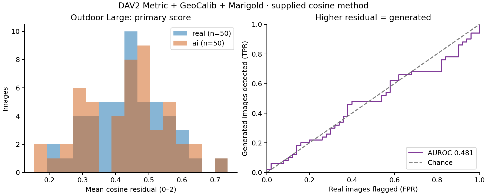
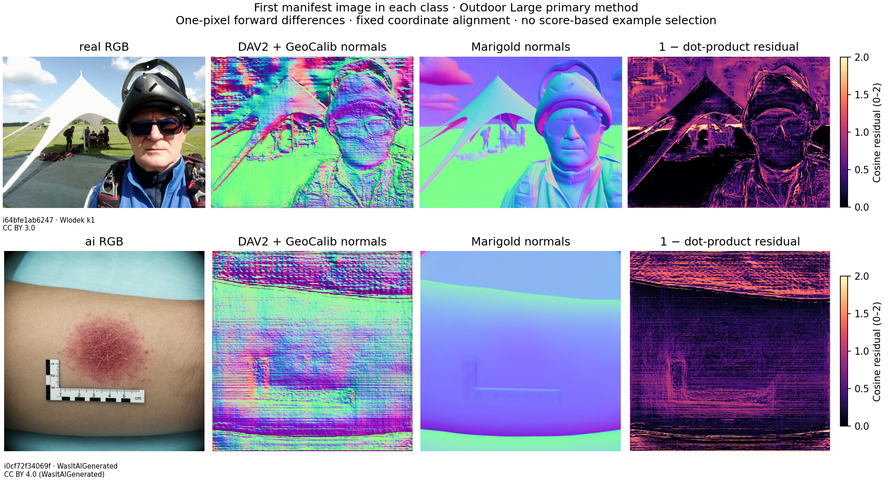

# Applying the supplied depth–normal cosine method

**50 real + 50 generated originals; primary AUROC 0.481** (95% stratified image-bootstrap interval **0.365–0.601**). Direction fixed before this run: higher residual means generated. AUROC 0.5 is chance and 1.0 is perfect ranking; AUROC is not classification accuracy.

The primary method does not establish reliable separation on this sample: its uncertainty interval includes chance. The score direction was not flipped or selected after seeing the result.

## Equations and actual pipeline

This run applies the supplied method: **Depth Anything V2 Metric → GeoCalib camera intrinsics → 3D back-projection → one-pixel forward differences → depth-derived normals → comparison with Marigold Normals**.

For predicted axial depth Z and intrinsics K:

`P(u,v) = Z(u,v) K^-1 [u,v,1]^T`

`duP = P(u+1,v) - P(u,v)` and `dvP = P(u,v+1) - P(u,v)`

`ND = normalize(duP × dvP)`

After deterministic camera-facing orientation and coordinate-convention conversion:

`E(u,v) = 1 - clip(dot(ND(u,v), NP(u,v)), -1, 1)`

**Image score = arithmetic mean of E over valid interior pixels.** Both normal vectors are unit length. E is 0 for agreement, 1 for orthogonal directions, and 2 for opposite directions. It is not a depth-error percentage. The last row/column and invalid/degenerate prediction stencils are excluded; no sky, object-edge or learned-confidence mask is applied. There is no absolute dot product, fitted rotation, sign fitting against Marigold, or ground-truth scale correction. Camera-facing orientation uses camera geometry, not reference normals.

The mean residual was computed directly at each pixel. It was **not** obtained as `1-cos(mean angle)`: that nonlinear conversion does not commute with averaging.

## Primary result: Outdoor Large

| Class | Images | Mean cosine residual (0–2) | Median image residual | Mean valid stencil coverage |
| --- | ---: | ---: | ---: | ---: |
| Real photos | 50 | 0.4408 | 0.4456 | 100.00% |
| Generated images | 50 | 0.4295 | 0.4435 | 100.00% |

All 100 images completed, with no omitted images. The model inputs matched the prior pilot's processed RGB hashes exactly. The original byte hashes and dataset labels/IDs match the unchanged manifest.

## Checkpoint and score sensitivity

| Checkpoint | Residual mean: real | Residual mean: generated | Mean-residual AUROC | Mean-angle AUROC |
| --- | ---: | ---: | ---: | ---: |
| Outdoor Large (primary) | 0.4408 | 0.4295 | 0.481 | 0.508 |
| Indoor Large (secondary) | 0.3229 | 0.2912 | 0.432 | 0.455 |

The outdoor checkpoint was selected before inference as the primary method for this mixed-content sample. The indoor checkpoint was applied to all 100 images as a separate sensitivity check. No scene classifier, label-based routing, or choice of the best result afterward was used. Angular-score columns use the **same DAV2/GeoCalib forward-difference normal maps and masks** as the residual columns and are secondary diagnostics.

## How this differs from the earlier pilot

| Component | Earlier pilot | This supplied-method run |
| --- | --- | --- |
| Depth | MoGe-2 Large | DAV2 Metric Large |
| Camera intrinsics | MoGe-2 estimates | GeoCalib pinhole |
| Derivatives | Four-pixel central differences | One-pixel forward differences |
| Primary score | Mean angular disagreement (degrees) | Mean cosine residual (0–2) |

The [earlier report](../stage2_frontier_100/REPORT.md) remains unchanged: its primary AUROC was 0.330. Multiple components change together here, so comparing the two headline scores cannot isolate the effect of the residual formula alone. The within-run angular columns above compare the two aggregations on the same new normal fields.

## Implementation details that matter

- GeoCalib does **not** independently learn all four fx, fy, cx, cy entries: its official pinhole implementation estimates focal calibration and fixes the principal point at the image center. K still has the supplied matrix form. Its wrapper restores K to the original canvas after internal resizing/cropping; focal lengths are in canvas pixel units.
- The primary DAV2 model is the pinned Metric Outdoor Large VKITTI checkpoint with max depth 80 m; the secondary is Metric Indoor Large Hypersim with max depth 20 m. Both use official fp32 `infer_image(input_size=518)` and strict checkpoint loading. All GeoCalib named parameters were also compared with checkpoint tensors after its official loader and matched.
- Marigold Normals v1.1 uses the same pinned fp16 weights/settings as before: four DDIM steps, ensemble ten, processing resolution 768, matching input resolution, deterministic image-ID seed. Its raw prediction is shared between the two depth-checkpoint comparisons.
- All three models start from identical RGB pixels: proportional LANCZOS resize to longest edge 1024, no crop or EXIF. Internal model preprocessing follows the official APIs, with depth, camera and normal outputs restored to the shared canvas. No measured depth, normals or camera calibration are available or supplied.
- Fixed camera-facing/OpenCV-to-Marigold right/up/toward-viewer convention conversion precedes comparison. The supplied unit-cross-product formula otherwise has a sign/convention ambiguity that would make dot products meaningless if left unaligned.

## Fixed examples

First manifest image in each class, selected without scores. The primary Outdoor Large normal map is displayed. Normal RGB encodes XYZ; residual colors share the full 0–2 scale.

Input credits: `i64bfe1ab6247`, Wlodek k1, CC BY 3.0 ([original photo](https://commons.wikimedia.org/wiki/File:Parachuting_at_the_Opole-Polska_Nowa_Wie%C5%9B_airfield,_2022.05.29_03.jpg)); `i0cf72f34069f`, WasItAIGenerated, CC BY 4.0, from the benchmark. Inputs are resized and derived geometry visualizations added. The assembled figure is CC BY 4.0 with these original credits retained. Full per-file source/license attribution remains in the unchanged [manifest](../../stage2/frontier_manifest.json).

## Interpretation and limitations

The primary method does not establish reliable separation on this sample: its uncertainty interval includes chance. The score direction was not flipped or selected after seeing the result.

This tests mutual agreement of estimates, **not geometric accuracy against measured truth**. A generated image can lead both estimators to a plausible, mutually consistent reconstruction; real photos can produce disagreement through camera error, sky, boundaries, fine textures and estimator error. Uniform depth scaling leaves normals unchanged, but spatially varying depth errors and wrong camera intrinsics can change them.

This is an exploratory follow-up on the **same previously inspected 100-image public split**. It is not a new independent held-out test, the publisher's private leaderboard, or a proof that any signal is caused by geometric inconsistency. The sample retains its 50 real/50 generated selection across 19 generators, with no social copies or videos. Source, content, aspect ratio and processing remain possible confounders. Image-bootstrap intervals assume independent images and can be optimistic under correlated content/sources. Estimator training-set overlap has not been exhaustively audited. With 50 real photos, empirical FPR steps are 2%, so 1% FPR performance cannot be established. No classifier was trained and no threshold was optimized.

## Reproduction, verification and cost

[Code/commands](../../stage2/README_COSINE.md) · [fixed protocol](../../stage2/PROTOCOL_COSINE.md) · [per-image scores](scores.csv) · [full records](per_image.jsonl) · [summary](summary.json) · [validation](verification.json) · [code verification](code_verification.json) · [checkpoint checks](checkpoint_verification.json) · [source commits](source_revisions.json) · [runtime](runtime_provenance.json) · [package versions](runtime_packages.json) · [new-run ledger](costs.json) · [raw-map hashes](prediction_map_hashes.json).

All 300 raw prediction arrays (two depth maps and one normal map per image) were retained locally with transfer SHA-256 checks. The arrays are excluded from Git; their file hashes and sizes are committed for later verification.

All HF weight hashes match published LFS SHA-256 values. For the GeoCalib GitHub release, no published SHA-256 was available in this workflow: file size and PyTorch ZIP CRC were checked, the actual SHA-256 recorded, and all named loaded parameters verified.

Estimated new-run cost: **$0.0844**, below the **$1.00** ceiling. Observed net account debit: $0.0805; billing/counters can lag. The RTX 3090 instance was **destroyed and confirmed absent from the instance list**. This ledger is separate from earlier runs.
