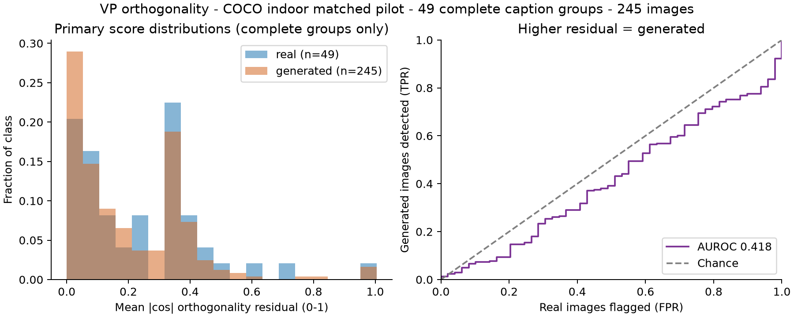
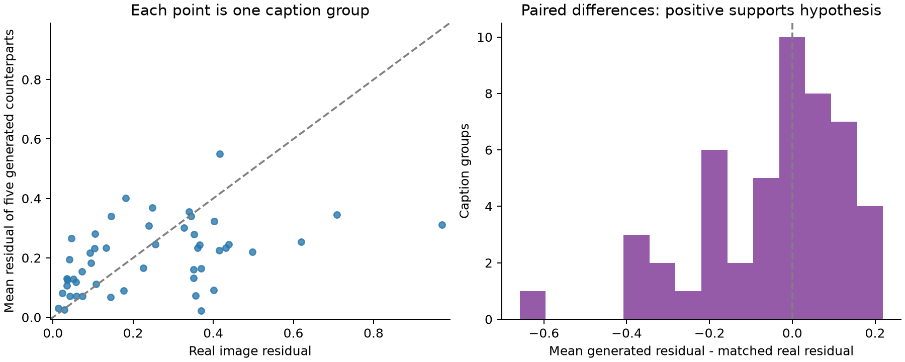
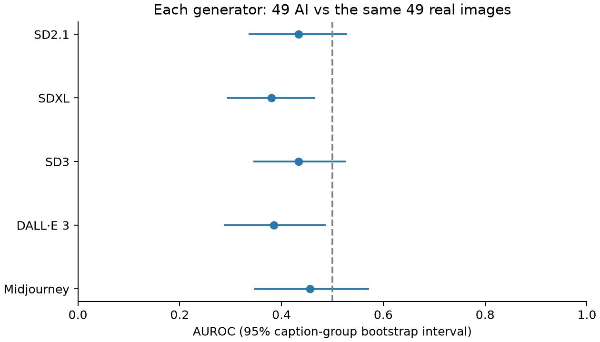

# Vanishing-point orthogonality on the COCO indoor caption-matched pilot

**Primary caption-matched AUROC (49 complete groups): 0.418**, 95% caption-group
bootstrap interval **0.346–0.489** — this interval is entirely below chance (0.5).
Higher score (vanishing-point directions further from orthogonal) was fixed before
this run as indicating generated (`stage3/PROTOCOL_VP.md`); it was not flipped. The
predeclared signal runs in the wrong direction on this sample: generated images'
line structure is *more* consistent with the orthogonality assumption than real
photos', not less.

This is the same 50-caption-group, 300-image sample as `results/stage2_coco_matched_300`
(50 real + 50 images from each of sd21/sdxl/sd3/dalle3/midjourney, from the user-provided
`coco_indoor_all.zip`, archive SHA-256 `c847a0655de51d16724852da1dbe155b0998b8941f80c8a47b2577b8dc71a089`,
verified before extraction). `K` was not re-estimated: it is the GeoCalib intrinsics
already cached in that run's `per_image.jsonl`, reused after verifying each image's
processed-canvas hash matched. No depth or normal network is used anywhere in this
pipeline. Compute cost was $0 (CPU only, no GPU rental, no paid API calls).

## One image produced no score

| id | label | generator | group | VPs found | lines detected |
| --- | --- | --- | --- | ---: | ---: |
| `i3b85a0ae90ed2c2a` | real | real | `c0962_3` | 0 | 28 |

Below the minimum-inliers threshold for even one vanishing point, so this image is
reported as insufficient structure, not imputed or dropped silently. Its whole caption
group (`c0962_3`) is excluded from the caption-matched analysis below, leaving 49
complete groups / 245 images. The pooled (non-matched) AUROC below uses every other
scored image (49 real + 250 generated = 299).

## Primary result: caption-matched analysis (49 complete groups, 245 images)

| | Mean orthogonality residual (0-1) | Median residual | Mean VPs found |
| --- | ---: | ---: | ---: |
| Real photos (n=49) | 0.2459 | 0.2252 | 3.00 |
| Generated, pooled (n=245) | 0.2127 | 0.1462 | 2.99 |

**Matched AUROC: 0.418**, 95% caption-group bootstrap interval **[0.346, 0.489]**.

**Paired contrast** (mean of each group's five generated residuals minus its real
residual, averaged over groups): **-0.0433**, 95% caption-group bootstrap interval
**[-0.0971, +0.0055]** — almost entirely below zero, consistent with the matched AUROC.

## Results by generator

Each row compares 49 generated images with the same 49 real references (the group
missing a real score is excluded from every row, not just its own generator).

| Generator | AUROC | 95% group-bootstrap interval | Mean generated - matched real | Generated above matched real |
| --- | ---: | ---: | ---: | ---: |
| SD2.1 | 0.434 | [0.336, 0.529] | -0.0360 | 40.8% |
| SDXL | 0.381 | [0.294, 0.466] | -0.0531 | 40.8% |
| SD3 | 0.434 | [0.345, 0.526] | -0.0339 | 46.9% |
| DALL·E 3 | 0.385 | [0.287, 0.488] | -0.0736 | 34.7% |
| Midjourney v6 | 0.456 | [0.347, 0.572] | -0.0198 | 51.0% |

**All five generators point the same direction here** — unlike the stage-2 depth-normal
result on this identical sample, which split cleanly into a significantly-reversed open-
diffusion family (SD2.1/SDXL/SD3) and a weakly-hypothesis-consistent frontier family
(DALL·E 3, Midjourney). For vanishing-point orthogonality, DALL·E 3 and Midjourney do
**not** break from the open-diffusion models; every generator here shows the same
reversed pattern, with SDXL and DALL·E 3 the most clearly below chance.

## A non-geometric confound check, repeated from the Frontier pilot

On the Frontier 100-image pilot (`results/stage3_frontier_vp`), raw LSD line count alone
was a better real-vs-generated separator (AUROC 0.637) than the geometric orthogonality
score (AUROC 0.528), suggesting a sharpness/texture artifact in that benchmark. The same
check here:

| Feature | AUROC (scored images, pooled) | 95% bootstrap interval |
| --- | ---: | ---: |
| Line-count only | 0.503 | [0.416, 0.580] |
| Orthogonality residual (primary, matched) | 0.418 | [0.346, 0.489] |

Line count is at chance on this sample (real mean 224 lines, generated mean 230 lines) —
the confound that dominated the Frontier pilot does not reproduce here. This makes the
reversed orthogonality result harder to dismiss as a trivial line-density artifact,
though it does not rule out other confounders (see below).

## Agreement with the stage-2 depth-normal cue on this same sample

Both independent 3D-consistency cues now point the same direction on this dataset:
generated images appear **more** self-consistent, not less.

| Cue | Pooled/matched AUROC | 95% interval | Direction |
| --- | ---: | ---: | --- |
| Depth-normal cosine residual (`stage2_coco_matched_300`) | 0.429 pooled | [0.366, 0.495] | reversed |
| Depth-normal paired contrast | -0.0248 | [-0.0471, -0.0021] | reversed, significant |
| Vanishing-point orthogonality (this run, matched) | 0.418 | [0.346, 0.489] | reversed, significant |
| Vanishing-point paired contrast | -0.0433 | [-0.0971, +0.0055] | reversed, borderline |

The two cues disagree on *which generators* drive the reversal (depth-normal: only the
open-diffusion family; vanishing points: all five, roughly evenly), but they agree that
the direction is reversed on this specific dataset. That consistency across two
unrelated measurement pipelines is itself the most interesting finding here, and it
points at something about this dataset rather than one buggy pipeline.

## Implementation details

Identical to `results/stage3_frontier_vp/REPORT.md`'s method: LSD line detection
(segments under 2% of the image diagonal dropped), sequential RANSAC for up to 3
vanishing points (500 trials/point, 2.0° inlier threshold, minimum 6 inliers, minimum 6
remaining lines to attempt another point, least-squares refinement), and the mean |cos|
orthogonality residual over all found vanishing-point pairs under the reused GeoCalib
`K`. No hyperparameter was changed between the two runs.

## Interpretation and limitations

- **The square-vs-non-square confound flagged in `stage2_coco_matched_300/REPORT.md`
  still applies unchanged**: 49 of the 50 real images have non-square original
  dimensions (cropped to square) while all 250 generated images are natively square.
  This pipeline cannot rule that confound in or out; it operates on the same processed
  canvas as the depth-normal run.
- This measures whether detected line structure is consistent with a Manhattan-world
  assumption under the `K` GeoCalib already predicted; any error in that cached
  calibration is inherited unchanged here.
- Caption matching controls prompt content, not camera, viewpoint, scene composition,
  or rendering complexity.
- No classifier was trained and no threshold was optimized. The declared direction of
  effect was not changed after seeing this result.
- Bootstrap intervals resample complete caption groups (2000 replicates, seed 180),
  preserving the real image and all five generated counterparts together, matching the
  stage-2 convention.
- This is a small pilot (49-50 usable groups) on five specific generator tags, not the
  full 16,452-image archive or a test against unseen generator families.

## Reproduction

[Protocol](../../stage3/PROTOCOL_VP.md) · [Geometry code](../../stage3/vp_geometry.py) ·
[Runner](../../stage3/run_vp.py) · [Analysis](../../stage3/analyze_coco_matched_vp.py) ·
[Settings](settings.json) · [Per-image records](per_image.jsonl) · [Scores](scores.csv) ·
[Group scores](group_scores.csv) · [Summary](summary.json)

The archive was obtained directly from the user and verified against the SHA-256 above
before extraction; image bytes are not committed. `K` was reused from
`results/stage2_coco_matched_300/per_image.jsonl` with no new GeoCalib inference.
