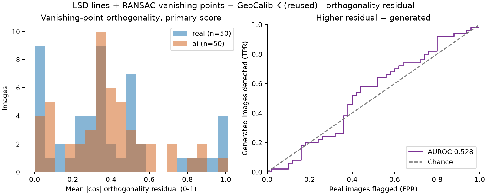

# Vanishing-point orthogonality on the Frontier 100-image pilot

**Primary AUROC: 0.528** (95% stratified image-bootstrap interval **0.418–0.641**). Higher
score (vanishing-point directions further from orthogonal) was fixed before this run as
indicating generated; see `stage3/PROTOCOL_VP.md`. The interval includes chance (0.5), so
this primary result does not establish reliable separation between real and generated
images on this sample.

This is the same 50 real + 50 generated original images as `results/stage2_frontier_100`
and `results/stage2_frontier_cosine` (Frontier Image & Video Benchmark, 2026-10,
revision `e6a8b83d15fab1da958848368fcd07e943afafd0`), downloaded fresh for this run and
verified byte-for-byte against the pinned manifest's SHA-256 before any processing. No
new image selection was done.

## What this measures

Line segments are detected with OpenCV's LSD on each image's grayscale canvas. Up to
three dominant vanishing points are found by sequential RANSAC, assuming a Manhattan-
world scene. For every pair of found vanishing points, `|cos|` is computed between
their back-projected 3D ray directions under the camera intrinsics `K` — **0 means the
two directions are orthogonal (expected for a real photo of an orthogonal room under
correct calibration), 1 means they are parallel (fully inconsistent)**. The per-image
score is the mean of this value over all found pairs. `K` was not re-estimated: it is
the GeoCalib intrinsics already cached in `results/stage2_frontier_cosine/per_image.jsonl`
for these same 100 images, reused after verifying the processed-canvas hash matched. No
depth or normal network is used anywhere in this pipeline; it is classical CV only, and
cost $0 in compute (CPU only, no GPU rental, no paid API calls — see `costs` note below).

## Primary result

| Class | Images | Mean orthogonality residual (0-1) | Median residual | Mean VPs found | Mean lines detected |
| --- | ---: | ---: | ---: | ---: | ---: |
| Real photos | 50 | 0.3851 | 0.3485 | 2.98 | 338.2 |
| Generated images | 50 | 0.3850 | 0.3656 | 2.96 | 249.5 |

Class means are nearly identical (0.3851 vs 0.3850); the median is slightly higher for
generated images, consistent with the fixed direction, but the gap is small relative to
the bootstrap interval above.

## Coverage

| | Count |
| --- | ---: |
| Images with 3 vanishing points found | 97 / 100 |
| Images with exactly 2 vanishing points found | 3 / 100 |
| Images with fewer than 2 (no score) | 0 / 100 |

Every image produced a score; coverage was not the limiting factor on this sample,
unlike the "insufficient structure" risk flagged as a concern in the protocol before
running. This benchmark is not restricted to indoor scenes, so this coverage number may
not generalize to the project's actual indoor COCO subset without re-checking.

## A non-geometric confound check (not the primary hypothesis)

The same table shows real photos had notably more detected line segments than generated
images (mean 338 vs 249). As a sanity check, raw line count alone — with no geometry, no
vanishing points, no camera model — was tested as a trivial classifier:

| Feature | AUROC (direction: fewer lines = generated) | 95% bootstrap interval |
| --- | ---: | ---: |
| Line-count only | 0.637 | [0.528, 0.743] |
| Orthogonality residual (primary) | 0.528 (higher = generated) | [0.418, 0.641] |

A trivial, non-geometric feature (how many line segments LSD finds at all) separates this
sample's two classes better than the intended geometric cue, and its interval only just
clears chance. This likely reflects a difference in image sharpness, compression, or
texture density between this benchmark's real and generated images rather than anything
about 3D consistency, and it is a caution about this sample, not a finding about
generated images in general. It was not used to pick or adjust the primary score.

## Implementation details

- Canvas: PIL LANCZOS resize to 1024-pixel long edge, aspect-preserving, no crop —
  identical to the stage-2 cosine run, verified by matching `processed_rgb_sha256`
  before reusing that run's `K` for each image.
- Line detector: `cv2.createLineSegmentDetector(cv2.LSD_REFINE_STD)`; segments shorter
  than 2% of the image diagonal are dropped.
- Vanishing points: sequential RANSAC, up to 3 per image, 500 trials per point, 2.0°
  inlier angular threshold, minimum 6 inliers to accept a point, minimum 6 remaining
  segments to attempt another point; refined by least squares (right null vector of the
  stacked line-coefficient matrix) over each accepted point's inliers.
- All hyperparameters above were fixed in `stage3/PROTOCOL_VP.md` before this run and
  were not changed afterward.

## Interpretation and limitations

- This measures whether detected line structure is consistent with a Manhattan-world
  assumption *under the K that GeoCalib already predicted*. Any error in that cached
  calibration is inherited here unchanged.
- This is the same 100 images already inspected in two prior stage-2 reports; it is an
  exploratory follow-up, not a new held-out test.
- The 50 generated images span 19 different generators with no stratification at this
  sample size (consistent with the stage-2 Frontier reports); no per-generator claim can
  be made here.
- No classifier was trained and no threshold was optimized. The declared direction of
  effect was not changed after seeing this result.
- Bootstrap intervals assume independent images; this sample may contain correlated
  content that the bootstrap does not resolve.
- This is a different failure mode from the stage-2 depth-normal residual (no depth or
  normal network involved), so it remains a candidate to combine as a second feature
  with that score, even though it shows no standalone separation here.

## Reproduction

[Protocol fixed before this run](../../stage3/PROTOCOL_VP.md) · [Geometry code](../../stage3/vp_geometry.py)
· [Runner](../../stage3/run_vp.py) · [Image fetcher](../../stage3/fetch_frontier_images.py)
· [Analysis](../../stage3/analyze_frontier_vp.py) · [Settings](settings.json) ·
[Per-image records](per_image.jsonl) · [Scores](scores.csv) · [Summary](summary.json)

All 100 original images were downloaded fresh from the pinned Frontier benchmark
revision for this run and verified against the manifest's SHA-256 before use; image
bytes are not committed. Compute cost was $0: no GPU was rented and no model API was
called — this pipeline is CPU-only classical CV plus a cached intrinsics lookup, run
locally.
